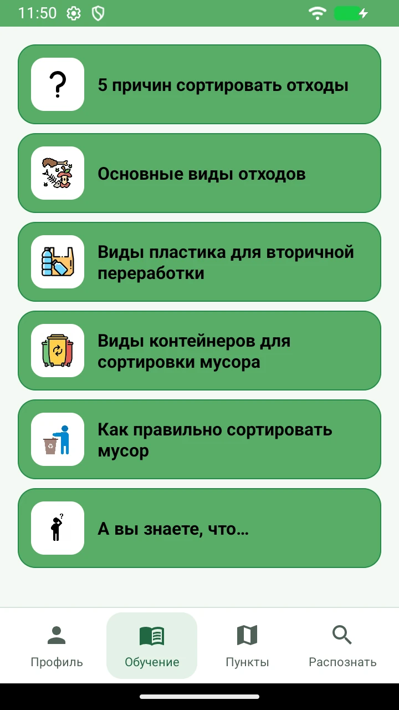
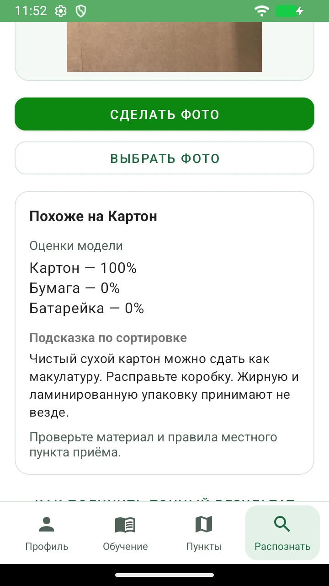
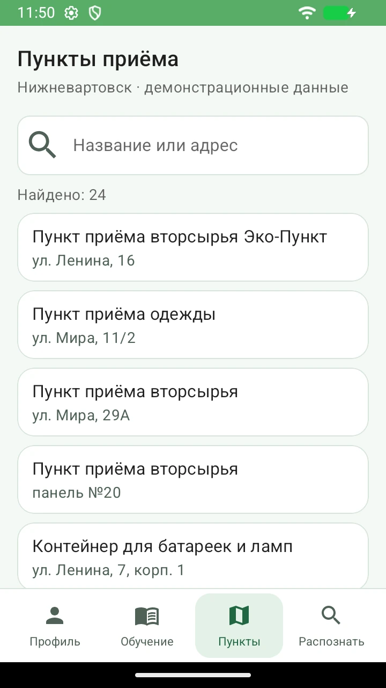

<h1 align="center">EcoSort</h1>

<p align="center">
  Помощник по раздельному сбору отходов: обучение, распознавание по фото и поиск пунктов приёма.
</p>

<p align="center">
  
  
  <br>
  
  
  
  
  
  
</p>

<p align="center">
  <a href="#возможности">Возможности</a> ·
  <a href="#скриншоты">Скриншоты</a> ·
  <a href="#технологии">Технологии</a> ·
  <a href="#быстрый-старт">Быстрый старт</a> ·
  <a href="#проверки">Проверки</a>
</p>

## О приложении

EcoSort помогает разобраться, как сортировать бытовые отходы и где можно сдать вторсырьё. Пользователь изучает правила в коротких уроках, фотографирует предмет для определения предполагаемой категории и ищет пункт приёма по названию или адресу.

Обучающие материалы, каталог и распознавание фотографий доступны без интернета. Для отображения карты требуется подключение к сети и ключ MapKit.

## Возможности

- **Обучение сортировке.** Шесть иллюстрированных материалов о видах отходов, пластике, контейнерах, правилах раздельного сбора и переработке.
- **Распознавание по фотографии.** Съёмка камерой или выбор готового снимка. Приложение показывает три предполагаемые категории с оценками модели и подсказку по сортировке.
- **Десять категорий.** Бумага, картон, пластик, стекло, металл, батарейки, органические отходы, одежда, обувь и прочие отходы.
- **Обработка неуверенного результата.** При неоднозначном прогнозе приложение предлагает изменить ракурс или фон. Предусмотрены сообщения для повреждённых и малодетальных снимков.
- **Каталог пунктов приёма.** Поиск по названию и адресу среди 24 демонстрационных записей Нижневартовска, просмотр списком и переход к расположению на карте.

## Скриншоты

<table>
  <tr>
    <th>Обучение</th>
    <th>Распознавание</th>
    <th>Пункты приёма</th>
  </tr>
  <tr>
    <td></td>
    <td></td>
    <td></td>
  </tr>
</table>

Кадры сняты на эмуляторе в разрешении 720 × 1280 (9:16). Экран распознавания показан после прокрутки к результату. [Атрибуция тестовой фотографии](docs/screenshots/ATTRIBUTION.txt).

## Технологии

| Задача | Технологии |
| --- | --- |
| Android-приложение | Java, Android SDK, AndroidX |
| Интерфейс | XML-макеты, Material Components, ConstraintLayout, RecyclerView |
| Анализ фотографий | LiteRT 1.4.2, готовая MobileNetV2 |
| Подготовка изображения | Уменьшение снимка, учёт поворота и отражения EXIF |
| Состояние распознавания | ViewModel, LiveData, SavedStateHandle |
| Карта | Yandex MapKit 4.5.0 |
| Проверки | JUnit, AndroidX Test, Espresso |
| Сборка | Gradle, Android Gradle Plugin |

### Распознавание на устройстве

В приложение встроена готовая MobileNetV2 с лицензией MIT. Файл модели занимает около 5,2 МБ. Анализ выполняется на CPU в фоновом потоке; фотографии не отправляются на сервер. Работа над этим сценарием включает интеграцию модели, подготовку изображений, обработку результатов и интерфейс.

Модель определяет категорию всего снимка, поэтому лучше фотографировать один предмет на простом фоне. Оценка модели не гарантирует правильность ответа и не определяет маркировку полимера или местные условия переработки.

Источник модели, лицензия, подготовка входных данных и ограничения описаны в [документации распознавания](docs/photo-recognition.md).

## Быстрый старт

Понадобятся JDK 17 или 21, Android SDK Platform 36.1 и Build Tools 36.1.0. Минимальная версия устройства — Android 5.0 (API 21).

```bash
git clone https://github.com/NewMrPotato/EcoSort.git
cd EcoSort
git switch dev
```

Откройте проект в Android Studio. Укажите путь к SDK через `ANDROID_HOME` или `sdk.dir` в локальном файле `local.properties`.

Сборка в Windows:

```powershell
.\gradlew.bat assembleDebug
```

В macOS и Linux:

```bash
./gradlew assembleDebug
```

APK появится в `app/build/outputs/apk/debug/app-debug.apk`.

### Настройка карты

Добавьте собственный ключ в `local.properties`:

```properties
MAPKIT_API_KEY=your_mapkit_api_key
```

Также можно передать `MAPKIT_API_KEY` через переменную окружения до сборки. Локальный файл с ключом исключён из Git. Без ключа доступны уроки, каталог, поиск и распознавание; карта не включается.

## Проверки

```powershell
.\gradlew.bat testDebugUnitTest
.\gradlew.bat connectedDebugAndroidTest
```

Для второй команды нужен подключённый Android-телефон или запущенный эмулятор. В macOS и Linux используйте `./gradlew`.

Локальные тесты проверяют поиск по каталогу и обработку оценок модели. Android-тесты проверяют запуск встроенной модели, EXIF-ориентацию, уменьшение больших фотографий, повреждённые и однотонные изображения, а также пересоздание экрана.

## Что где находится

| Часть проекта | Расположение |
| --- | --- |
| Основные экраны и обработчики | [app/src/main/java/com/rather/ecosort](app/src/main/java/com/rather/ecosort) |
| Классификатор и подготовка фотографий | [recognition](app/src/main/java/com/rather/ecosort/recognition) |
| Макеты экранов | [res/layout](app/src/main/res/layout) |
| Тексты, уроки и каталог | [res/values](app/src/main/res/values) |
| Модель и её лицензия | [assets/models](app/src/main/assets/models) |
| Локальные тесты | [app/src/test](app/src/test) |
| Android-тесты | [app/src/androidTest](app/src/androidTest) |

## Статус и материалы

Демонстрационная версия. Каталог содержит демонстрационные данные; перед поездкой нужно уточнять актуальность адресов и условия приёма. Вход и регистрация находятся на стадии прототипа.

- [Обезличенное описание функциональности](docs/application-description.txt).
- [Результаты исследования задачи](docs/research.md).
- [Модель, лицензия и проверка интеграции](docs/photo-recognition.md).
- [Отчёт проверочного прогона](docs/recognition-smoke-results.json).
